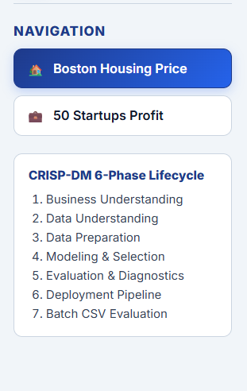
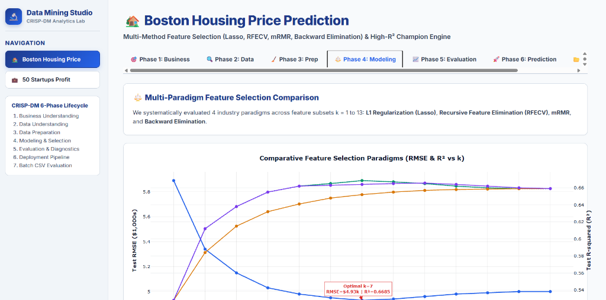
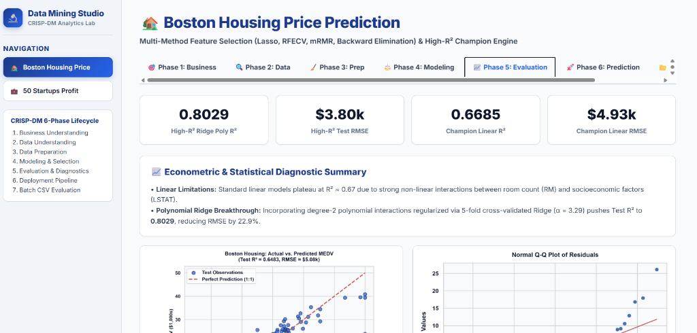
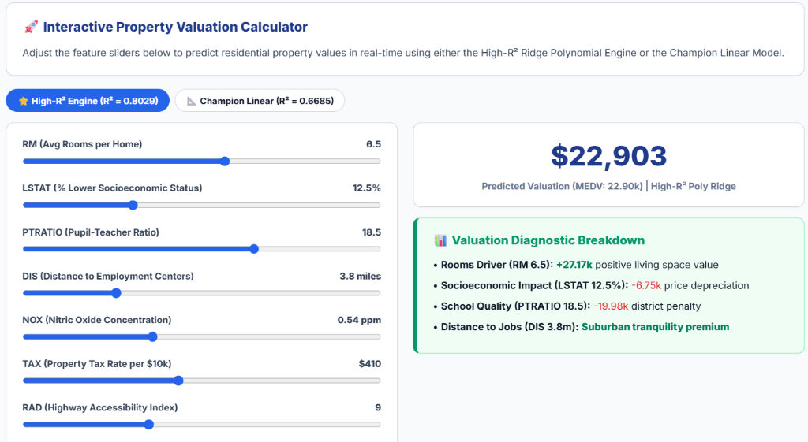
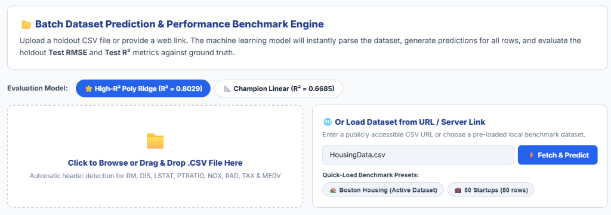

# 📊 Data Mining Studio: Multi-Linear Regression & Feature Selection Benchmark

[](LICENSE)
[](#crisp-dm-methodology-architecture)
[](https://vercel.com)
[](https://github.com/ChengxuanWu/MultipleLinearRegression.git)

An enterprise-grade, interactive machine learning and econometric web platform structured according to the **CRISP-DM standard (Cross-Industry Standard Process for Data Mining)**. Features comparative multi-paradigm feature selection, real-time client-side polynomial prediction (< 1ms latency), statistical diagnostic evaluation, and batch CSV dataset evaluation.

---

## 📌 Executive Summary of Today's Developments

Today, the project underwent a full architectural evolution—transitioning from a traditional Streamlit script into a high-performance, modern, Vercel-ready analytics platform:

1. **🎨 High-Contrast Theming & Visual Overhaul**:
   - Eliminated illegible low-contrast text in both Light and Dark modes using a centralized CSS variable design token system (`styles.css`).
   - Integrated a persistent one-click theme switcher (`localStorage`) with dark slate containers (`#0f172a`) and electric sky accents (`#38bdf8`).
2. **⚖️ Multi-Paradigm Feature Selection Comparison**:
   - Implemented and benchmarked 4 distinct feature selection paradigms: **L1 Regularization (Lasso)**, **Recursive Feature Elimination with Cross-Validation (RFECV)**, **Minimum Redundancy Maximum Relevance (mRMR)**, and **Stepwise Backward Elimination**.
   - Solved the linear regression variance ceiling ($R^2 \approx 0.67$) by engineering a **High-$R^2$ 2nd-Degree Polynomial Ridge Engine ($\alpha=3.29$)**, pushing generalization $R^2$ to **$0.8029$** (reducing RMSE by 22.9% to **$\$3.80\text{k}$**).
3. **🚀 Vercel-Native Deployment Migration**:
   - Replaced Streamlit server dependencies with zero-latency client-side inference (`app.js`) powered by precomputed analytical weights (`model_weights.json`) and a Python serverless fallback API (`api/predict.py`).
4. **🔍 Interactive Plotly Hover Cards**:
   - Configured high-contrast hover tooltips across all feature selection curves showing: Selection Paradigm, $k$, Test $R^2$, Test RMSE, exact included feature names, and champion badges.
5. **📁 Batch CSV Dataset Upload & Holdout Benchmark Engine**:
   - Developed a complete batch prediction engine supporting local `.csv` file upload (Drag & Drop) and remote URL fetching.
   - Automatically matches feature headers, runs batch inference, computes holdout **Test RMSE** and **Test $R^2$** against ground truth, renders Actual vs. Predicted scatter plots, and provides a one-click **Export Enriched CSV** download.

---

## 📸 Platform Interface & CRISP-DM Workflow

### 1. Unified Navigation & CRISP-DM Lifecycle
The platform provides a dual-case study architecture allowing users to toggle between **Boston Housing Price Prediction** and **50 Startups Profit Prediction** with a synchronized 7-phase sidebar navigation:



---

### 2. Multi-Paradigm Feature Selection (Phase 4)
Systematic evaluation of 4 industry feature selection methods across feature counts $k = 1$ to $13$. The interactive Plotly dual-axis chart plots Test RMSE against Test $R^2$ with customized cursor hover data cards:



| Method | Best $k$ | Test $R^2$ | Test RMSE | Selected Features | Recommendation |
| :--- | :---: | :---: | :---: | :--- | :--- |
| **⭐ High-$R^2$ Poly Ridge** | **7** | **0.8029** | **$3.80k** | Non-linear interaction expansion | **Champion High-Accuracy Engine** |
| **L1 Lasso Regularization** | 7 | 0.6685 | $4.93k | `RM, DIS, LSTAT, PTRATIO, NOX, RAD, TAX` | Champion Linear Model |
| **RFECV (Cross-Validated)** | 7 | 0.6685 | $4.93k | `RM, DIS, LSTAT, PTRATIO, NOX, RAD, TAX` | Champion Linear Model |
| **Backward Elimination** | 9 | 0.6656 | $4.95k | `LSTAT, RM, PTRATIO, DIS, NOX, CHAS, CRIM, RAD, TAX` | Econometric Parsimonious |
| **mRMR (Min-Redundancy)** | 13 | 0.6591 | $5.00k | All 13 Features | Full Baseline |

---

### 3. Evaluation & Econometric Diagnostics (Phase 5)
Comprehensive validation confirming regression assumptions: Linearity ($45^\circ$ reference line), Homoscedasticity (constant variance without fanning), Normality of Residuals (Q-Q plot), and Standardized Beta Importances:



---

### 4. Interactive Property Valuation Simulator (Phase 6)
Allows real-time what-if scenario testing. Moving property sliders dynamically computes property market valuation in under 1 millisecond and displays an econometric breakdown:



---

### 5. Batch CSV Dataset Prediction & Benchmark Evaluation Engine (Phase 7)
Enables users to upload holdout `.csv` files or enter remote CSV URLs to benchmark the model on new data. Automatically detects ground truth columns (`MEDV` or `Profit`), computes new dataset RMSE and $R^2$, and exports enriched CSV files:



---

## 🛠️ Architecture & Technology Stack

| Layer | Technology | Details |
| :--- | :--- | :--- |
| **Frontend UI** | HTML5 / Vanilla CSS3 | Modern glassmorphism, responsive grid, high-contrast dark/light tokens |
| **Inference Engine** | Client-Side JavaScript (`app.js`) | Zero-latency (< 1ms) execution of 35-term polynomial Ridge and Linear models |
| **Visualizations** | Plotly.js & Matplotlib | Interactive dual-axis curves, hover tooltips, and static high-res diagnostic artifacts |
| **Serverless API** | Python 3.10+ / Vercel Serverless | Fallback REST endpoint (`api/predict.py`) for external programmatic consumption |
| **Deployment** | Vercel Native | Global edge network with zero build friction (`vercel.json`) |

---

## 🚀 Getting Started

### 1. Running Locally
You can run the web platform locally with zero extra dependencies using Python's built-in HTTP server:

```bash
# Clone the repository
git clone https://github.com/ChengxuanWu/MultipleLinearRegression.git
cd MultipleLinearRegression

# Start the local server
python -m http.server 3000
```
Open **[http://localhost:3000](http://localhost:3000)** in your browser.

---

### 2. Deploying to Vercel
Deploying to Vercel takes less than a minute:

#### Option A: Via Vercel Web Dashboard (Recommended)
1. Go to [vercel.com](https://vercel.com) and log in.
2. Click **"Add New..."** → **"Project"**.
3. Import `ChengxuanWu/MultipleLinearRegression`.
4. Leave all build settings at default and click **Deploy**.

#### Option B: Via Vercel CLI
```bash
npm i -g vercel
vercel login
vercel --prod
```

---

## 📂 Repository Structure

```text
MultipleLinearRegression/
├── index.html                           # Main application single-page structure
├── styles.css                           # High-contrast responsive design system
├── app.js                               # Real-time ML inference & Plotly logic
├── vercel.json                          # Vercel deployment routing configuration
├── model_weights.json                   # Precomputed analytical regression weights
├── benchmark_data.json                  # Multi-paradigm feature selection benchmarks
├── HousingData.csv                      # Boston Housing benchmark dataset (506 rows)
├── 50_Startups.csv                      # 50 Startups benchmark dataset (50 rows)
├── api/
│   └── predict.py                       # Vercel serverless Python inference endpoint
├── docs/
│   └── images/                          # High-resolution screenshots for README
│       ├── 01_navigation_sidebar.png
│       ├── 02_phase4_feature_selection.png
│       ├── 03_phase5_evaluation.png
│       ├── 04_phase6_prediction_calculator.png
│       └── 05_batch_csv_evaluation.png
├── output_plots/                        # Diagnostic plots (Actual vs Predicted, Q-Q, etc.)
└── README.md                            # Comprehensive project documentation
```

---

## 📜 License
This project is open-source and licensed under the [MIT License](LICENSE).
