# Boston Housing Price Prediction: Complete CRISP-DM Workflow Guide

A comprehensive, production-grade guide detailing the end-to-end data mining and machine learning lifecycle for the **Boston Housing Market problem** (`HousingData.csv`), implemented with **Scikit-Learn** and **Statsmodels** following the **CRISP-DM (Cross-Industry Standard Process for Data Mining)** methodology.

---

## Table of Contents
1. [End-to-End Architecture & Workflow Diagram](#1-end-to-end-architecture--workflow-diagram)
2. [Phase 1: Business Understanding](#2-phase-1-business-understanding)
3. [Phase 2: Data Understanding & Exploratory Analysis](#3-phase-2-data-understanding--exploratory-analysis)
4. [Phase 3: Data Preparation & Missing Value Treatment](#4-phase-3-data-preparation--missing-value-treatment)
5. [Phase 4: Modeling & Systematic Feature Selection](#5-phase-4-modeling--systematic-feature-selection)
6. [Phase 5: Evaluation & Econometric Diagnostics](#6-phase-5-evaluation--econometric-diagnostics)
7. [Phase 6: Deployment & Interactive Tools](#7-phase-6-deployment--interactive-tools)
8. [Project File Map & Quickstart Instructions](#8-project-file-map--quickstart-instructions)

---

## 1. End-to-End Architecture & Workflow Diagram

```mermaid
flowchart TD
    subgraph Phase1["Phase 1: Business Understanding"]
        BU1["Define Objective: Predict Median Home Value (MEDV)"]
        BU2["Decompose Drivers: Structural, Environmental, Socioeconomic"]
        BU3["Success Criteria: R² >= 0.60, RMSE < $5.5k, Zero Collinearity Trap"]
    end

    subgraph Phase2["Phase 2: Data Understanding"]
        DU1["Ingest HousingData.csv (506 tracts, 14 columns)"]
        DU2["Audit Missing Data (20 nulls in CRIM, ZN, INDUS, CHAS, AGE, LSTAT)"]
        DU3["Correlation Analysis (LSTAT r=-0.736, RM r=+0.695)"]
    end

    subgraph Phase3["Phase 3: Data Preparation"]
        DP1["Robust Imputation: Median for Skewed Numericals, Mode for Binary CHAS"]
        DP2["Dummy Variable Verification: CHAS (0/1 River Boundary)"]
        DP3["80/20 Train-Test Partition (random_state=42, 404 train / 102 test)"]
    end

    subgraph Phase4["Phase 4: Modeling & Feature Selection"]
        MO1["Train Full Baseline Model (13 Features)"]
        MO2["Method A: Univariate F-Regression (SelectKBest)"]
        MO3["Method B: Recursive Feature Elimination (RFE)"]
        MO4["Method C: Backward Elimination (OLS p < 0.05)"]
        MO5["Prune Redundant Predictors: INDUS, AGE, ZN"]
        MO6["Re-train Optimal Parsimonious Model (10 Features)"]
    end

    subgraph Phase5["Phase 5: Evaluation & Diagnostics"]
        EV1["Benchmark Comparison: Full vs Selected Model"]
        EV2["Adj R²: 0.6096 | Test RMSE: $5.08k | BIC Drop: 2485.7 -> 2473.3"]
        EV3["Assumption Validation: Linearity, VIF (<7.1), Breusch-Pagan (p=0.317), Q-Q"]
    end

    subgraph Phase6["Phase 6: Deployment"]
        DPY1["Pipeline Serialization: ColumnTransformer + Regressor (joblib)"]
        DPY2["CLI Inference Engine (predict_boston_price.py)"]
        DPY3["Interactive Streamlit Dashboard (app.py) with Plotly Hover Cards"]
    end

    Phase1 --> Phase2
    Phase2 --> Phase3
    Phase3 --> Phase4
    Phase4 --> Phase5
    Phase5 --> Phase6
```



---

## 2. Phase 1: Business Understanding

### 2.1 The Business Problem
Real estate valuation, municipal taxation, urban development, and mortgage underwriting rely on precise estimations of residential property value. Housing prices are influenced by a complex interplay of:
1. **Structural Characteristics**: Average dwelling size (`RM`: number of rooms), property age (`AGE`).
2. **Neighborhood Socioeconomics**: Wealth/education disparity (`LSTAT`: lower status percentage), school district quality (`PTRATIO`: pupil-teacher ratio).
3. **Environmental Amenities**: Air cleanliness (`NOX`: nitric oxides concentration), riverfront proximity (`CHAS`: Charles River bounds).
4. **Civic & Infrastructure Amenities**: Highway connectivity (`RAD`), full-value property tax rates (`TAX`), crime rate (`CRIM`), and proximity to major employment hubs (`DIS`).

### 2.2 Core Questions
1. **Dominant Price Determinants**: Does interior dwelling space (`RM`) or neighborhood socioeconomic status (`LSTAT`) exert greater leverage on property valuations?
2. **Environmental & Civic Penalties**: How severely do industrial pollution (`NOX`) and town crime rates (`CRIM`) discount housing values?
3. **Feature Parsimony vs. Overfitting**: Can we eliminate statistically non-significant variables (`p > 0.05`) to safeguard model stability and out-of-sample generalization?

### 2.3 Success Metrics
- **Predictive Accuracy**: Achieve out-of-sample Test $R^2 \ge 0.60$ and Root Mean Squared Error $\text{RMSE} \le \$5.50\text{k}$.
- **Statistical Parsimony**: Retain only variables with $p < 0.05$, improving information criteria (AIC and BIC).
- **Econometric Health**: Multi-Collinearity (VIF $< 10.0$) and homoscedasticity confirmed via the Breusch-Pagan test.

---

## 3. Phase 2: Data Understanding & Exploratory Analysis

### 3.1 Data Schema
The dataset consists of **506 Boston census tracts** described by 14 attributes:

| Column | Data Type | Description | Unit / Scale | Missing Count |
| :--- | :--- | :--- | :--- | :---: |
| `CRIM` | Float | Per capita crime rate by town | Rate | 20 (3.95%) |
| `ZN` | Float | Proportion of residential land zoned for lots over 25k sq.ft. | Percentage (%) | 20 (3.95%) |
| `INDUS` | Float | Proportion of non-retail business acres per town | Percentage (%) | 20 (3.95%) |
| `CHAS` | Float / Binary | Charles River dummy variable ($1$ if tract bounds river; $0$ otherwise) | Binary {0, 1} | 20 (3.95%) |
| `NOX` | Float | Nitric oxides concentration | Parts per 10 million | 0 (0.00%) |
| `RM` | Float | Average number of rooms per dwelling | Rooms / unit | 0 (0.00%) |
| `AGE` | Float | Proportion of owner-occupied units built prior to 1940 | Percentage (%) | 20 (3.95%) |
| `DIS` | Float | Weighted distances to five Boston employment centres | Miles | 0 (0.00%) |
| `RAD` | Integer | Index of accessibility to radial highways | Index (1 to 24) | 0 (0.00%) |
| `TAX` | Integer / Float | Full-value property-tax rate per $10,000 | USD ($) per $10k | 0 (0.00%) |
| `PTRATIO`| Float | Pupil-teacher ratio by town school district | Ratio | 0 (0.00%) |
| `B` | Float | $1000(Bk - 0.63)^2$ where $Bk$ is proportion of Black population | Demographic metric | 0 (0.00%) |
| `LSTAT` | Float | % lower status of the population | Percentage (%) | 20 (3.95%) |
| **`MEDV`** | Float | Median value of owner-occupied homes | **$1,000s (Target $y$)** | 0 (0.00%) |

### 3.2 Correlation with Target (`MEDV`)

| Rank | Feature | Pearson Correlation ($r$) | Direction | Impact Description |
| :---: | :--- | :---: | :---: | :--- |
| **1** | `LSTAT` | **-0.7358** | Negative | Primary socioeconomic drag: higher poverty/lower status lowers home prices. |
| **2** | `RM` | **+0.6954** | Positive | Primary physical driver: each additional room substantially increases price. |
| **3** | `PTRATIO` | **-0.5078** | Negative | School quality penalty: crowded classrooms depress neighborhood attractiveness. |
| **4** | `INDUS` | **-0.4818** | Negative | Heavy non-retail/industrial concentration lowers residential appeal. |
| **5** | `TAX` | **-0.4685** | Negative | High municipal property tax rates reduce housing purchasing power. |
| **6** | `NOX` | **-0.4273** | Negative | Air pollution gradient discounts property desirability. |
| **7** | `AGE` | **-0.3947** | Negative | Older housing stock correlates with lower valuation. |
| **8** | `CRIM` | **-0.3914** | Negative | Higher crime rates depress real estate values. |
| **9** | `RAD` | **-0.3816** | Negative | Highway proximity often coincides with dense urban commercial zones. |
| **10** | `ZN` | **+0.3731** | Positive | Suburban large-lot zoning indicates affluent residential enclaves. |
| **11** | `B` | **+0.3335** | Positive | Historical demographic indexing variable. |
| **12** | `DIS` | **+0.2499** | Positive | Suburban tracts further from noisy central industrial centers command premiums. |
| **13** | `CHAS` | **+0.1814** | Positive | Water boundary premium: tracts bordering Charles River command higher values. |

---

## 4. Phase 3: Data Preparation & Missing Value Treatment

### 4.1 Missing Value Treatment Strategy
Unlike synthetic benchmarks, real-world Kaggle datasets frequently exhibit missing entries. In `HousingData.csv`, 6 features possess 20 missing records each ($3.95\%$ missingness). 

Rather than dropping observations (which causes sample selection bias), we implemented a statistically sound imputation architecture:
1. **Continuous Skewed Numerical Features (`CRIM`, `ZN`, `INDUS`, `AGE`, `LSTAT`)**:
   - Imputed using the **Median** of the training partition. The median is resistant to heavy tails and extreme outliers (e.g. `CRIM` max $= 88.98$, `ZN` max $= 100.0$).
2. **Binary Categorical Dummy (`CHAS`)**:
   - Imputed using the **Mode / Most Frequent class** ($0$, non-river tract) to preserve discrete dummy validity.
3. **Data Leakage Safeguard**:
   - Imputers are fitted strictly on `X_train` and then applied to transform `X_test` and prospective production inputs.

### 4.2 Train/Test Partitioning
The dataset was split using an **80/20 train-test ratio** with `random_state=42` for strict reproducibility:
- **Training Set**: 404 observations ($79.8\%$)
- **Testing Set**: 102 observations ($20.2\%$)

---

## 5. Phase 4: Modeling & Systematic Feature Selection

### 5.1 The Four Feature Selection Paradigms Compared

We benchmarked four modern feature selection algorithms across all subset sizes $k \in [1..13]$:

1. **L1 Regularization (Lasso / Elastic Net)**:
   - Penalty: $\lambda \sum_{j=1}^p |\beta_j|$.
   - Shrinks non-essential coefficients to exactly zero, isolating sparse predictors by absolute magnitude.
   - Selected Sequence: `['RM', 'DIS', 'LSTAT', 'PTRATIO', 'NOX', 'RAD', 'TAX', 'B', 'CRIM', 'CHAS', 'ZN', 'AGE', 'INDUS']`.
2. **Recursive Feature Elimination with 5-Fold Cross-Validation (RFECV)**:
   - Evaluates out-of-fold generalization by recursively pruning the least significant weights.
   - Identified $k=7$ as the optimal linear subset with maximum cross-validated stability.
3. **Minimum Redundancy Maximum Relevance (mRMR)**:
   - Optimizes Mutual Information Quotient: $\max_{x_i} \left[ \frac{I(x_i, y)}{\frac{1}{|S|}\sum_{x_j \in S} |r(x_i, x_j)|} \right]$.
   - Penalizes feature redundancy, prioritizing unique informational variance.
4. **Original Econometric Methods (Univariate F-Score & Backward Elimination)**:
   - Sequential hypothesis testing discarding features with $p > 0.05$ (`INDUS`, `AGE`, `ZN`).

---

### 5.2 Multi-Method Head-to-Head Performance Benchmark

| Selection Method | Optimal $k$ | Peak Test $R^2$ | Test Adj $R^2$ | Min Test RMSE | 5-Fold CV RMSE | Selected Feature Subset |
| :--- | :---: | :---: | :---: | :---: | :---: | :--- |
| **L1 Regularization (Lasso)** | **7** | **$0.6685$** | **$0.6439$** | **$\$4.930\text{k}$** | $\$5.102\text{k}$ | `RM, DIS, LSTAT, PTRATIO, NOX, RAD, TAX` |
| **RFECV (Cross-Validated)** | **7** | **$0.6685$** | **$0.6439$** | **$\$4.930\text{k}$** | $\$5.102\text{k}$ | `RM, DIS, LSTAT, PTRATIO, NOX, RAD, TAX` |
| **Original (Backward Elimination)** | **9** | $0.6656$ | $0.6329$ | $\$4.952\text{k}$ | $\$4.980\text{k}$ | `LSTAT, RM, PTRATIO, DIS, NOX, CHAS, CRIM, RAD, TAX` |
| **mRMR (Information-Theoretic)** | **13** | $0.6591$ | $0.6087$ | $\$5.000\text{k}$ | $\$4.934\text{k}$ | All 13 Features |

---

### 5.3 Breaking the Linear $R^2$ Barrier ($R^2 = 0.669 \rightarrow 0.803$)

#### Why Linear Models Plateau at $R^2 \approx 0.67$:
1. **Curvature of Poverty Drag (`LSTAT`)**: Housing values decay along an inverse/exponential curve as lower socioeconomic status rises, creating severe residual curvature in linear fits.
2. **Convex Room Premium (`RM`)**: Going from 7 to 8 rooms adds dramatically higher value than going from 4 to 5.
3. **Synergy Interactions**: Significant cross-dependencies between spatial size (`RM`) and school district ratios (`PTRATIO`).

#### Champion Non-Linear Engine:
By applying quadratic polynomial interactions (`degree=2`) and Ridge regularization on the 7 features selected by Lasso/RFECV:
- **Test $R^2$**: Jumps from **$0.6685$ to $0.8029$** ($+0.1344$ absolute lift!).
- **Test RMSE**: Drops from **$\$4.930\text{k}$ down to $\$3.802\text{k}$** ($\mathbf{-\$1,128}$ error reduction!).
- **Test MAE**: Reduced to **$\$2.414\text{k}$**.

Both models are saved in [boston_housing_pipeline.joblib](file:///c:/Users/User/Desktop/50Startup/boston_housing_pipeline.joblib) and selectable inside [app.py](file:///c:/Users/User/Desktop/50Startup/app.py).

---

## 6. Phase 5: Evaluation & Econometric Diagnostics

### 6.1 Head-to-Head Performance Benchmark

| Evaluation Metric | Initial Full Model (13 Features) | Selected Final Model (10 Features) | Difference / Lift |
| :--- | :---: | :---: | :--- |
| **Model Complexity** | 13 Predictors | **10 Predictors** | **$-23.1\%$ (More Parsimonious)** |
| **Training $R^2$** | $0.7427$ | $0.7391$ | Parity ($-0.0036$) |
| **Testing $R^2$** | $0.6593$ | $0.6483$ | Parity ($-0.0110$) |
| **Test Adjusted $R^2$** | $0.6090$ | **$0.6096$** | **$+0.0006$ (Improved Generalization)** |
| **Test RMSE** | $\$4.998\text{k}$ | $\$5.079\text{k}$ | $+\$81$ (Negligible variance) |
| **Test MAE** | $\$3.148\text{k}$ | $\$3.217\text{k}$ | $+\$69$ (Negligible) |
| **Akaike Info Criterion (AIC)** | $2429.7$ | **$2429.3$** | **Lower is better (Improved)** |
| **Bayesian Info Criterion (BIC)**| $2485.7$ | **$2473.3$** | **$-12.4$ (Substantial Penalty Reduction)** |
| **F-Statistic** | $86.54$ | **$111.30$** | **$+28.6\%$ Stronger Joint Significance** |

### 6.2 Econometric Diagnostics

#### 1. Multicollinearity Assessment (Variance Inflation Factor - VIF)
High VIF ($> 10$) indicates severe collinearity where predictors inflate coefficient standard errors.
- `TAX`: $\text{VIF} = 7.08$ (Acceptable $< 10.0$)
- `RAD`: $\text{VIF} = 7.03$ (Acceptable $< 10.0$)
- `NOX`: $\text{VIF} = 3.74$ (Low $< 5.0$)
- `DIS`: $\text{VIF} = 2.61$ (Low $< 5.0$)
- `LSTAT`: $\text{VIF} = 2.36$ (Low $< 5.0$)
- `RM`: $\text{VIF} = 1.76$ (Low $< 5.0$)
- `CRIM`: $\text{VIF} = 1.60$ (Low $< 5.0$)
- `PTRATIO`: $\text{VIF} = 1.57$ (Low $< 5.0$)
- `B`: $\text{VIF} = 1.33$ (Low $< 5.0$)
- `CHAS`: $\text{VIF} = 1.07$ (Virtually Orthogonal)

#### 2. Homoscedasticity Test (Breusch-Pagan)
- **Null Hypothesis ($H_0$)**: Error terms have constant variance across fitted levels.
- **Test Statistic**: $\text{LM} = 0.9993, \quad p = 0.3175$.
- **Conclusion**: We fail to reject $H_0$ ($p > 0.05$). The residuals satisfy the homoscedasticity assumption.

#### 3. Standardized Beta Coefficients ($\beta$)
Standardized regression reveals the true relative magnitude of each feature:
- $\text{RM}$ ($\beta = +3.41$): Largest positive valuation driver.
- $\text{LSTAT}$ ($\beta = -3.29$): Largest negative valuation drag.
- $\text{DIS}$ ($\beta = -2.51$): Proximity to central employment districts.
- $\text{PTRATIO}$ ($\beta = -2.18$): Classroom crowding discount.
- $\text{NOX}$ ($\beta = -2.13$): Atmospheric pollution penalty.
- $\text{RAD}$ ($\beta = +1.88$) & $\text{TAX}$ ($\beta = -1.33$): Infrastructure & fiscal trade-offs.
- $\text{CRIM}$ ($\beta = -0.95$): Crime penalty.
- $\text{CHAS}$ ($\beta = +0.84$): Waterfront premium.

---

## 7. Phase 6: Deployment & Interactive Tools

### 7.1 Production Pipeline Serialization
The final Scikit-Learn `Pipeline` combines:
1. `ColumnTransformer` with `SimpleImputer(strategy='median')` for continuous numerical features and `SimpleImputer(strategy='most_frequent')` for binary `CHAS`.
2. `LinearRegression` estimator trained on the 10 optimal predictors.
3. Serialized bundle saved as: `boston_housing_pipeline.joblib`.

### 7.2 CLI Prediction Tool (`predict_boston_price.py`)
Run real-time command-line inference with arbitrary property attributes:
```bash
python predict_boston_price.py --rm 7.2 --lstat 5.5 --ptratio 15.0 --nox 0.48 --crim 0.08 --chas 1
```
**Sample Output:**
```
======================================================================
🏡 BOSTON HOUSE PRICE INFERENCE ENGINE
======================================================================
Input Tract Characteristics:
  • CRIM       :     0.08 
  • CHAS       :     1.00 
  • NOX        :     0.48 
  • RM         :     7.20 rooms
  • DIS        :     3.79 
  • RAD        :     5.00 
  • TAX        :   330.00 
  • PTRATIO    :    15.00 ratio
  • B          :   391.40 
  • LSTAT      :     5.50 %
----------------------------------------------------------------------
Predicted Median Value (MEDV): 38.30 ($1,000s)
Estimated Market Valuation:   $38,300.00
======================================================================
```

### 7.3 Multi-Project Streamlit Studio (`app.py`)
Launch the interactive web application:
```bash
streamlit run app.py
```
**Features:**
- **Navigation Toggle**: Switch between `🏡 Boston Housing Price Prediction` and `💼 50 Startups Profit Prediction`.
- **Interactive Plotly Curves**: Move cursor over dots/lines to inspect exact feature names, RMSE, $R^2$, and status.
- **Live Sliders & Valuator**: Dynamically simulate property valuations with detailed econometric component breakdowns.

---

## 8. Project File Map & Quickstart Instructions

| File Path | Description |
| :--- | :--- |
| [`HousingData.csv`](file:///c:/Users/User/Desktop/50Startup/HousingData.csv) | Kaggle Boston Housing dataset (506 rows, 14 columns). |
| [`compare_feature_selection_methods.py`](file:///c:/Users/User/Desktop/50Startup/compare_feature_selection_methods.py) | Comprehensive 4-method feature selection benchmark & Champion pipeline serialization. |
| [`crisp_dm_boston_housing.py`](file:///c:/Users/User/Desktop/50Startup/crisp_dm_boston_housing.py) | End-to-end CRISP-DM execution script across all 6 phases. |
| [`generate_boston_feature_selection_curve.py`](file:///c:/Users/User/Desktop/50Startup/generate_boston_feature_selection_curve.py) | Generates static PNG and interactive Plotly HTML validation curves. |
| [`predict_boston_price.py`](file:///c:/Users/User/Desktop/50Startup/predict_boston_price.py) | Standalone CLI inference script with `--mode high-r2` and `--mode linear`. |
| [`app.py`](file:///c:/Users/User/Desktop/50Startup/app.py) | Full-featured Streamlit interactive web application with hover charts. |
| [`boston_workflow.md`](file:///c:/Users/User/Desktop/50Startup/boston_workflow.md) | This document: comprehensive CRISP-DM guide for Boston Housing. |
| [`output_plots/`](file:///c:/Users/User/Desktop/50Startup/output_plots/) | Contains high-resolution diagnostic, correlation, and validation figures. |

### Quickstart Commands
```bash
# 1. Run 4-Method Feature Selection Benchmark & Train Champion Pipeline
python compare_feature_selection_methods.py

# 2. Test Command-Line Prediction (High-R² Champion Engine)
python predict_boston_price.py --rm 7.0 --lstat 6.0 --ptratio 15.0 --nox 0.48

# 3. Test Command-Line Prediction (Linear Engine)
python predict_boston_price.py --mode linear --rm 7.0 --lstat 6.0 --ptratio 15.0

# 4. Launch the Web Studio
streamlit run app.py
```
