# 50 Startups Profit Prediction: Complete CRISP-DM Workflow Guide

A comprehensive, production-grade guide detailing the end-to-end data mining and machine learning lifecycle for the **50 Startups problem**, implemented with **Scikit-Learn** following the **CRISP-DM (Cross-Industry Standard Process for Data Mining)** methodology.

---

## Table of Contents
1. [End-to-End Architecture & Workflow Diagram](#1-end-to-end-architecture--workflow-diagram)
2. [Phase 1: Business Understanding](#2-phase-1-business-understanding)
3. [Phase 2: Data Understanding & Exploratory Analysis](#3-phase-2-data-understanding--exploratory-analysis)
4. [Phase 3: Data Preparation & One-Hot Encoding](#4-phase-3-data-preparation--one-hot-encoding)
5. [Phase 4: Modeling & Systematic Feature Selection](#5-phase-4-modeling--systematic-feature-selection)
6. [Phase 5: Evaluation & Econometric Diagnostics](#6-phase-5-evaluation--econometric-diagnostics)
7. [Phase 6: Deployment & Interactive Tools](#7-phase-6-deployment--interactive-tools)
8. [Project File Map & Quickstart Instructions](#8-project-file-map--quickstart-instructions)

---

## 1. End-to-End Architecture & Workflow Diagram

```mermaid
flowchart TD
    subgraph Phase1["Phase 1: Business Understanding"]
        BU1["Define Objective: Forecast Startup Profit"]
        BU2["Evaluate ROI of R&D, Admin, Marketing & State"]
        BU3["Success Criteria: R² >= 0.85, Low Error, High Interpretability"]
    end

    subgraph Phase2["Phase 2: Data Understanding"]
        DU1["Load 50_Startups.csv (50 rows, 5 cols)"]
        DU2["Data Profiling & Summary Statistics"]
        DU3["Correlation Analysis (R&D r=0.973, Mkt r=0.748)"]
    end

    subgraph Phase3["Phase 3: Data Preparation"]
        DP1["Check Missing Values & Zero Expenditures"]
        DP2["One-Hot Encoding on 'State' (drop='first')"]
        DP3["Address Dummy Variable Trap"]
        DP4["80/20 Train/Test Partition (random_state=42)"]
    end

    subgraph Phase4["Phase 4: Modeling & Feature Selection"]
        MO1["Train Initial Full Model (5 Predictors)"]
        MO2["Method A: Backward Elimination (p-val & AIC)"]
        MO3["Method B: Scikit-Learn RFE & SelectKBest"]
        MO4["Identify Optimal Features: [R&D Spend, Marketing Spend]"]
        MO5["Re-train Final Parsimonious Model"]
    end

    subgraph Phase5["Phase 5: Evaluation & Diagnostics"]
        EV1["Head-to-Head Comparison: Full vs Final Model"]
        EV2["Adj R² Lift: 77.2% -> 89.3% | RMSE Drop: $9,056 -> $8,206"]
        EV3["Assumptions: Linearity, VIF, Homoscedasticity, Normality"]
    end

    subgraph Phase6["Phase 6: Deployment"]
        DPY1["Scikit-Learn Pipeline Serialization (joblib)"]
        DPY2["CLI Prediction Tool (predict_profit.py)"]
        DPY3["Interactive Streamlit Web Dashboard (app.py)"]
    end

    Phase1 --> Phase2
    Phase2 --> Phase3
    Phase3 --> Phase4
    Phase4 --> Phase5
    Phase5 --> Phase6
```



---

## 2. Phase 1: Business Understanding

### 2.1 The Business Problem
Venture capital investors, private equity analysts, and startup founders operate under severe capital constraints. When allocating seed or expansion capital, leadership must decide how to divide funding across:
- **Research & Development (R&D)**: Core technology, engineering, intellectual property.
- **Administration**: Executive management, accounting, legal, and operational overhead.
- **Marketing Spend**: User acquisition, advertising campaigns, and public relations.
- **Location (State)**: Choosing between tech hubs like California, New York, or Florida.

### 2.2 Core Questions
1. **Marginal Return on Capital**: What is the expected profit return for each additional dollar invested in R&D vs. Administration vs. Marketing?
2. **Geographic Advantage**: Does being incorporated in California, Florida, or New York provide a statistically significant profit boost after controlling for expenditures?
3. **Model Simplicity vs. Accuracy**: Can we build a parsimonious model that eliminates statistical noise while maximizing out-of-sample prediction accuracy?

### 2.3 Success Metrics
- **Statistical Significance**: Keep features with $p < 0.05$ or proven contribution to Adjusted $R^2$.
- **Predictive Accuracy**: Achieve out-of-sample Test $R^2 > 0.85$ and Mean Absolute Percentage Error (MAPE) $< 12\%$.
- **Econometric Soundness**: Pass classical regression assumptions without multicollinearity (VIF $< 5.0$).

---

## 3. Phase 2: Data Understanding & Exploratory Analysis

### 3.1 Data Schema
The dataset consists of **50 startup observations** with 5 variables:

| Column Name | Type | Description | Unit / Scale |
| :--- | :--- | :--- | :--- |
| `R&D Spend` | Continuous Float | Expenditure in engineering and innovation | USD ($) |
| `Administration` | Continuous Float | Operational and management overhead | USD ($) |
| `Marketing Spend` | Continuous Float | Advertising and customer acquisition spend | USD ($) |
| `State` | Categorical String | Operating state (`California`, `Florida`, `New York`) | Nominal |
| `Profit` | Continuous Float | Annual net profit earned | **Target ($y$)** |

### 3.2 Summary Statistics

| Statistic | R&D Spend ($) | Administration ($) | Marketing Spend ($) | Profit ($) |
| :--- | :---: | :---: | :---: | :---: |
| **Mean** | $73,721.62$ | $121,344.64$ | $211,025.10$ | $112,012.64$ |
| **Standard Deviation** | $45,902.26$ | $28,017.80$ | $122,290.31$ | $40,306.18$ |
| **Minimum** | $0.00$ | $51,283.14$ | $0.00$ | $14,681.40$ |
| **25th Percentile** | $39,936.37$ | $103,730.88$ | $129,300.13$ | $90,138.90$ |
| **Median (50th)** | $73,051.08$ | $122,699.80$ | $212,716.24$ | $107,978.19$ |
| **75th Percentile** | $101,602.80$ | $144,842.18$ | $299,469.08$ | $139,765.98$ |
| **Maximum** | $165,349.20$ | $182,645.56$ | $471,784.10$ | $192,261.83$ |

### 3.3 Correlation Analysis (Pearson Correlation $r$)

| Variable | R&D Spend | Administration | Marketing Spend | Profit | Interpretation |
| :--- | :---: | :---: | :---: | :---: | :--- |
| **R&D Spend** | **1.0000** | 0.2420 | 0.7242 | **0.9729** | Extremely strong linear association |
| **Administration** | 0.2420 | **1.0000** | -0.0322 | **0.2007** | Very weak, non-significant association |
| **Marketing Spend** | 0.7242 | -0.0322 | **1.0000** | **0.7478** | Moderate-strong positive association |
| **Profit** | **0.9729** | 0.2007 | 0.7478 | **1.0000** | Target variable |

---

## 4. Phase 3: Data Preparation & One-Hot Encoding

### 4.1 Data Cleaning & Zero Values Check
- **Missing Values**: 0 nulls across all 50 rows.
- **Zero Values**:
  - `R&D Spend`: 2 startups had $\$0$ spend (early ideation stage).
  - `Marketing Spend`: 3 startups had $\$0$ spend (pure word-of-mouth).
  - These are legitimate domain values, not measurement errors, and are retained.

### 4.2 One-Hot Encoding & The Dummy Variable Trap
Linear Regression requires numerical inputs. The nominal categorical attribute `State` has 3 classes:
- California: 17
- New York: 17
- Florida: 16

#### The Dummy Variable Trap
If all 3 classes are encoded into 3 binary columns ($D_{\text{CA}}, D_{\text{FL}}, D_{\text{NY}}$), their sum across every observation is always identically $1$:
$$D_{\text{CA}} + D_{\text{FL}} + D_{\text{NY}} = 1$$
This creates **perfect multicollinearity** with the intercept column ($\beta_0 \times 1$). The matrix $X^T X$ becomes singular (non-invertible), destabilizing coefficient estimation.

#### Implementation with `drop='first'`:
```python
from sklearn.preprocessing import OneHotEncoder

encoder = OneHotEncoder(drop='first', sparse_output=False)
state_dummies = encoder.fit_transform(X[['State']])
```
- **California** serves as the reference baseline ($D_{\text{FL}} = 0, D_{\text{NY}} = 0$).
- **`State_Florida`**: $1$ if Florida, $0$ otherwise.
- **`State_New York`**: $1$ if New York, $0$ otherwise.

### 4.3 Feature Partitioning (Train/Test Split)
- **Train Set**: $80\%$ ($40$ startups) used for model fitting and feature elimination.
- **Test Set**: $20\%$ ($10$ startups) held out for unbiased out-of-sample validation.
- **Random State**: Set to `42` (or `0` for specific benchmark replication) to guarantee reproducibility.

---

## 5. Phase 4: Modeling & Systematic Feature Selection

### 5.1 Multiple Linear Regression Mathematical Formulation
The full regression model is specified as:
$$y = \beta_0 + \beta_1 X_{\text{R\&D}} + \beta_2 X_{\text{Admin}} + \beta_3 X_{\text{Mkt}} + \beta_4 D_{\text{FL}} + \beta_5 D_{\text{NY}} + \epsilon$$

Fitting this model on the training set yields:
$$\text{Profit} = \$54,028.04 + 0.8056(\text{R\&D}) - 0.0688(\text{Admin}) + 0.0299(\text{Mkt}) + 938.79(\text{FL}) + 6.99(\text{NY})$$

| Feature | Coefficient ($\beta_i$) | Std Error | $t$-statistic | $p$-value | Significance ($\alpha=0.05$) |
| :--- | :---: | :---: | :---: | :---: | :---: |
| **Intercept** | **54,028.04** | 8,457.29 | 6.388 | $< 0.001$ | Significant |
| **R&D Spend** | **+0.8056** | 0.052 | 15.383 | **$< 0.001$** | **Highly Significant** |
| **Administration** | **-0.0688** | 0.061 | -1.133 | 0.265 | Insignificant (Overhead) |
| **Marketing Spend** | **+0.0299** | 0.022 | 1.346 | 0.187 | Borderline |
| **State_Florida** | **+938.79** | 3,893.51 | 0.241 | 0.811 | Insignificant |
| **State_New York** | **+6.99** | 3,882.77 | 0.002 | 0.999 | Insignificant |

---

### 5.2 Feature Selection Methods

#### Method 1: Econometric Backward Elimination (Stepwise $p$-value & AIC)
Starting with all features, in each step the predictor with the highest $p$-value above $\alpha = 0.05$ is iteratively pruned:

| Step | Remaining Features | Pruned Feature | $p$-value | Adjusted $R^2$ | AIC | Action |
| :---: | :--- | :--- | :---: | :---: | :---: | :--- |
| **1** | R&D, Admin, Mkt, State_FL, State_NY | `State_New York` | **0.9986** | 0.9469 | 853.27 | **Drop `State_New York`** |
| **2** | R&D, Admin, Mkt, State_FL | `State_Florida` | **0.7755** | 0.9484 | 851.27 | **Drop `State_Florida`** |
| **3** | R&D, Admin, Mkt | `Administration` | **0.2570** | 0.9497 | 849.36 | **Drop `Administration`** |
| **4** | **R&D Spend, Marketing Spend** | *None* | **0.0552** | **0.9493** | **848.81** | **Optimal Model (Lowest AIC)** |

#### Method 2: Scikit-Learn RFE & SelectKBest Ranking
- **Standardized RFE (`n_features_to_select=2`)**: Selected `['R&D Spend', 'Marketing Spend']`.
- **`SelectKBest(f_regression)`** Rankings:
  1. `R&D Spend`: $F = 676.10, p < 10^{-20}$
  2. `Marketing Spend`: $F = 56.69, p = 4.78 \times 10^{-9}$
  3. `State_New York`: $F = 0.42, p = 0.5189$
  4. `State_Florida`: $F = 0.35, p = 0.5578$
  5. `Administration`: $F = 0.31, p = 0.5798$

---

### 5.3 Feature Subsets Validation Curves & Benchmark Table

Testing performance curves across feature subset sizes $k = 1, 2, 3, 4, 5$:

| Number of Features | Selected Features | RMSE ($) | $R^2$ | Status |
| :---: | :--- | :---: | :---: | :--- |
| **1** | `[R&D Spend]` | 8,274.87 | 0.9465 | Under-specified |
| **2** | **`[R&D Spend, Marketing Spend]`** | **8,198.80** | **0.9474** | **Optimal: Minimum RMSE & Peak $R^2$** |
| **3** | `[R&D Spend, Marketing Spend, State_New York]` | 8,309.06 | 0.9460 | Noise added; RMSE climbs |
| **4** | `[R&D Spend, Marketing Spend, State_New York, State_Florida]` | 8,409.92 | 0.9447 | Degraded by dummy noise |
| **5** | `[R&D Spend, Marketing Spend, State_New York, State_Florida, State_California]` | 9,137.99 | 0.9347 | Overfitted & Multicollinear |

---

### 5.4 Re-training the Final Model
Re-training Scikit-Learn's `LinearRegression` strictly on the optimal feature subset produces:

$$\mathbf{\text{Final Retrained Regression Equation:}}$$
$$\mathbf{\text{Profit} = \$45,542.39 + (0.7834 \times \text{R\&D Spend}) + (0.0392 \times \text{Marketing Spend})}$$

---

## 6. Phase 5: Evaluation & Econometric Diagnostics

### 6.1 Head-to-Head Performance (Unseen Test Set)

| Evaluation Metric | Initial Full Model (5 Features) | Final Selected Model (2 Features) | Difference / Lift |
| :--- | :---: | :---: | :--- |
| **Number of Features** | 5 | **2** | **$-60\%$ Complexity** |
| **Test Set $R^2$** | 0.8987 | **0.9168** | **$+1.8\%$ Higher Explained Variance** |
| **Test Adjusted $R^2$** | 0.7721 | **0.8931** | **$+12.1\%$ Substantial Lift** |
| **Test Set RMSE** | $\$9,055.96$ | **$\$8,206.33$** | **$-\$849.63$ Error Reduction** |
| **Test Set MAE** | $\$6,961.48$ | **$\$6,469.18$** | **$-\$492.30$ Error Reduction** |
| **Test Set MAPE** | 10.28% | **8.84%** | **$-1.44\%$ Higher Relative Precision** |

### 6.2 Econometric Diagnostics
1. **Linearity**: Confirmed via Actual vs. Predicted scatter plot adhering tightly along the $45^\circ$ line.
2. **Multicollinearity (VIF)**:
   - `R&D Spend`: $\text{VIF} = 2.62$
   - `Marketing Spend`: $\text{VIF} = 2.70$
   - Both are far below the warning threshold of $5.0$.
3. **Homoscedasticity**: Residuals vs. Fitted plot demonstrates constant variance without funnel/cone shapes.
4. **Normality of Errors**: Standardized residuals closely track the theoretical Gaussian quantiles on the Q-Q plot.

---

## 7. Phase 6: Deployment & Interactive Tools

### 7.1 Reusable Scikit-Learn Pipeline
The production model encapsulates feature selection and inference into a single serialized pipeline:

```python
from sklearn.pipeline import Pipeline
from sklearn.compose import ColumnTransformer
from sklearn.linear_model import LinearRegression

pipeline = Pipeline([
    ('selector', ColumnTransformer([
        ('keep_top_features', 'passthrough', ['R&D Spend', 'Marketing Spend'])
    ], remainder='drop')),
    ('regressor', LinearRegression())
])
pipeline.fit(X_train, y_train)
```

### 7.2 Deployment Utilities
1. **Interactive Streamlit Web Dashboard (`app.py`)**:
   - Executive Overview & KPI cards.
   - One-Hot Encoding visualizer.
   - Interactive Plotly Feature Selection Curves with cursor hover data cards.
   - Live profit simulation sliders.
2. **CLI Prediction Utility (`predict_profit.py`)**:
   - Callable Python function `predict_startup_profit(rd, admin, mkt, state)` for batch or command-line valuations.

---

## 8. Project File Map & Quickstart Instructions

### 8.1 File Map
```
c:\Users\User\Desktop\50Startup/
├── 50_Startups.csv                        # Raw dataset
├── crisp_dm_50_startups.py               # Complete CRISP-DM execution script
├── generate_feature_selection_curve.py   # Curve generator & validation table
├── update_plots_transparent.py           # High-resolution plot generator
├── predict_profit.py                     # CLI inference script
├── app.py                                # Interactive Streamlit dashboard
├── 50_startups_pipeline.joblib           # Serialized Scikit-Learn model pipeline
├── workflow.md                           # This complete documentation guide
└── output_plots/                         # Visual artifacts
    ├── 01_correlation_heatmap.png
    ├── 03_profit_by_state.png
    ├── 04_actual_vs_predicted_final.png
    ├── 06_residuals_normality_qq.png
    ├── 08_feature_selection_comparison.png
    ├── feature_selection_metrics_curve.png
    └── interactive_feature_selection_curve.html
```

### 8.2 Quickstart Commands

#### 1. Run the Full CRISP-DM Training Pipeline:
```bash
python crisp_dm_50_startups.py
```

#### 2. Run the Interactive Web Dashboard:
```bash
streamlit run app.py
```

#### 3. Run Quick CLI Inferences:
```bash
python predict_profit.py
```

#### 4. Re-generate Exact Feature Selection Validation Curves:
```bash
python generate_feature_selection_curve.py
```
